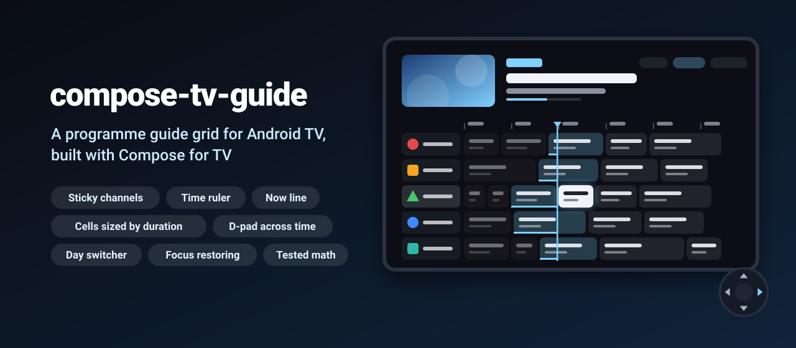
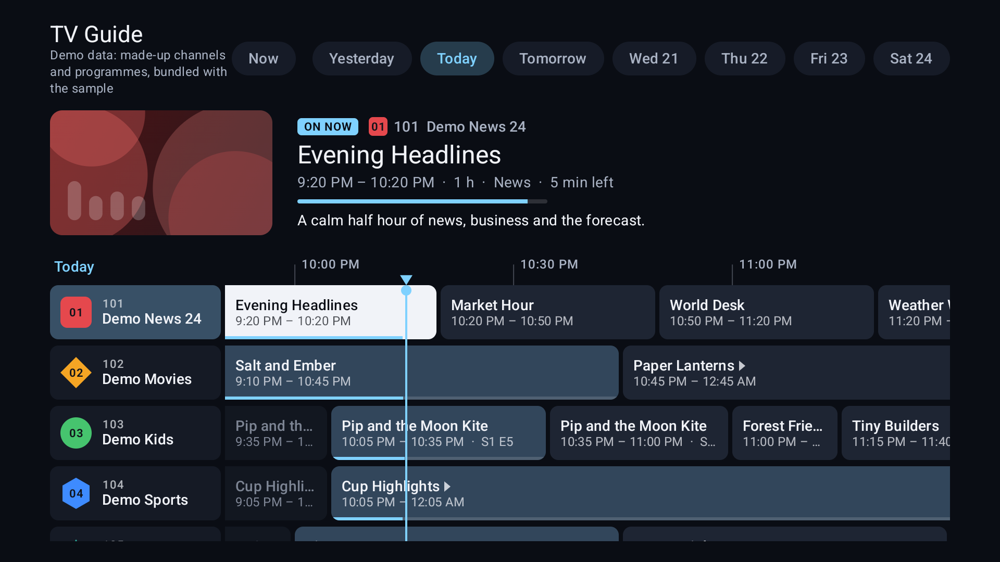
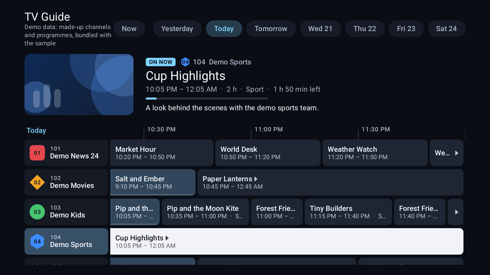
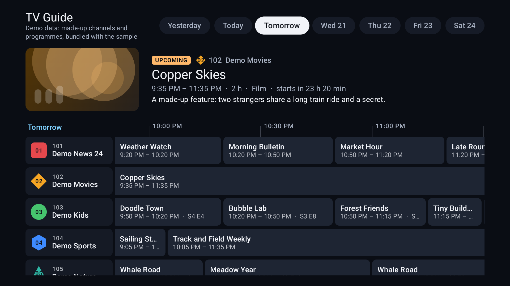

<p align="center">
  
</p>

<p align="center">
  <a href="https://github.com/halilozel1903/compose-tv-guide/actions/workflows/ci.yml"></a>
  <a href="https://jitpack.io/#halilozel1903/compose-tv-guide"></a>
  
  
  
  
  <a href="LICENSE"></a>
</p>

**compose-tv-guide** is an electronic programme guide (EPG) for Android TV, built with Compose for TV. Channels run down a sticky column, time runs along a sticky ruler, and every programme is a cell as wide as it is long. A line marks the current time, past, live and upcoming programmes look different, and the D-pad moves through time the way a TV guide should: left and right go to the previous and next programme, up and down keep the same column of time, and the grid scrolls to keep the focused programme in view. Only what is on screen is composed. The layout math (time to pixels, clipping at the window edges, focus neighbour search, scroll targets) is a plain Kotlin module with unit tests.

```kotlin
val state = rememberTvGuideState()

TvGuide(
    channels = channels,
    programmes = { channel -> schedule[channel.id].orEmpty() },
    window = GuideDays.window(LocalDate.now(), ZoneId.systemDefault()),
    channelKey = { it.id },
    programmeKey = { it.id },
    programmeTime = { TimeSpan(it.startMillis, it.endMillis) },
    channelCell = { channel, _ -> GuideChannelContent(channel.name, number = channel.number) },
    state = state,
    onProgrammeClick = { channel, programme -> play(channel, programme) },
) { _, programme ->
    GuideProgrammeContent(title = programme.title)
}
```

## Screenshots

Captured from the sample app on an Android TV emulator (1080p) by CI. The sample shows a **bundled demo guide**: twelve made-up channels called "Demo ..." with generated schedules and invented titles, and channel logos drawn as simple shapes. None of it is real-world data and nothing comes from the network; the app says so on screen.

| The guide at the current time | A focused programme in the hero area | Tomorrow in the day switcher |
| :---: | :---: | :---: |
|  |  |  |

## Why

Compose for TV has focusable surfaces, cards and lazy rows, but not a programme guide. A guide is a two dimensional grid where cells have different widths, the channel column and the time ruler must not scroll away, programmes cross the edges of the day, and the default focus search does not work: the next programme to the right may not be composed yet, and moving down from a two hour film should land on what is on at the time you were looking at, not on whatever cell happens to be closest. compose-tv-guide does this with its own virtualization and D-pad handling, and keeps the math in `compose-tv-guide-core`, a pure Kotlin module with 53 unit tests.

## Features

- **`TvGuide`**: the whole guide. A sticky channel column, a sticky time ruler with a label every 30 minutes, and programme cells sized by duration (`minuteWidth` dp per minute).
- **Lazy in both directions**: only the channel rows and programme cells on screen are composed, plus a little overscan, so hundreds of channels and a week of programmes are fine. A channel's programmes are only read when its row is shown or navigated through.
- **D-pad focus across time**: left and right go to the previous and next programme; up and down keep a time anchor and pick the programme on at that time (or the nearest one across a gap), skipping empty channels. The grid scrolls just enough to keep the focused cell in view; long programmes need only half of the screen.
- **Focus restoration**: focus coming back into the guide (from a header, a menu or the day switcher) returns to the programme it left. `scrollToNow()` and friends move that target too.
- **Now line and status styling**: a line and a ruler marker at the current time, and different colours for past, live (with a progress bar) and upcoming programmes. `rememberGuideNow()` updates every 30 seconds.
- **Clipping at the window edges**: a programme that started yesterday or ends tomorrow is cut at the edge and marked with a small arrow. Titles of long programmes stick to the left edge while you scroll through them.
- **Details panel slot**: `details = { channel, programme -> ... }` shows the focused programme above the grid or at its end.
- **Day switcher**: `GuideDaySwitcher` with "Yesterday", "Today", "Tomorrow" and dated chips; `GuideDays.window()` gives the window of a day, also for broadcast days that start at 06:00 and on daylight saving days.
- **State API**: `rememberTvGuideState()`, `scrollToNow()`, `scrollToChannel()`, `scrollToTime()`, `focusProgramme()`, `requestFocus()`. Focus and scroll position survive process death.
- **Your data, your cells**: the guide is generic over your channel and programme types. Cells get a `GuideProgrammeScope` with status, progress, focus, clipping and the time text; `GuideProgrammeContent` and `GuideChannelContent` are ready-made contents.

## Installation

Add JitPack to `settings.gradle.kts`:

```kotlin
dependencyResolutionManagement {
    repositories {
        google()
        mavenCentral()
        maven("https://jitpack.io")
    }
}
```

Then the dependency:

```kotlin
dependencies {
    implementation("com.github.halilozel1903.compose-tv-guide:compose-tv-guide:1.0.0")
    // Pure Kotlin layout math only (for JVM modules or tests):
    // implementation("com.github.halilozel1903.compose-tv-guide:compose-tv-guide-core:1.0.0")
}
```

The library brings `androidx.tv:tv-material` 1.1.0 as an `api` dependency and needs minSdk 26 (it uses `java.time`). Your app's manifest should declare that it runs on TV:

```xml
<uses-feature android:name="android.software.leanback" android:required="false" />
<uses-feature android:name="android.hardware.touchscreen" android:required="false" />
```

> The build is also set up for Maven Central (`io.github.halilozel1903:compose-tv-guide`) via the vanniktech publish plugin.

## Usage

**A day of programmes with a day switcher**

```kotlin
val zone = remember { ZoneId.systemDefault() }
val today = remember { GuideDays.dayOf(System.currentTimeMillis(), zone) }
var day by rememberSaveable { mutableStateOf(today) }
val state = rememberTvGuideState()

Column {
    GuideDaySwitcher(
        days = GuideDays.range(today, before = 1, after = 6),
        selected = day,
        onSelect = { day = it },
        today = today,
    )
    TvGuide(
        channels = channels,
        programmes = { channel -> repository.programmes(channel.id) },
        window = GuideDays.window(day, zone),            // or GuideDays.window(day, zone, startHour = 6)
        channelKey = { it.id },
        programmeKey = { it.id },
        programmeTime = { TimeSpan(it.start, it.end) },
        channelCell = { channel, isFocusedRow ->
            GuideChannelContent(channel.name, number = channel.number) { AsyncImage(channel.logoUrl, null) }
        },
        state = state,
        zone = zone,
        details = { channel, programme -> ProgrammeDetails(channel, programme) },
        onProgrammeClick = { channel, programme -> open(channel, programme) },
    ) { channel, programme ->
        GuideProgrammeContent(title = programme.title, subtitle = "$timeText  ·  ${programme.genre}")
    }
}
```

Switching days keeps the time of day and the channel: at 20:00 today, tomorrow opens at 20:00 too.

**State**

```kotlin
val state = rememberTvGuideState(initialChannelIndex = 0, initialTime = null)  // null = what is on now

state.requestFocus()                       // move focus into the guide
scope.launch { state.scrollToNow() }       // now a quarter into the screen, focus on what is on now
scope.launch { state.scrollToChannel(42) } // channel 42 at the top, same time column
scope.launch { state.scrollToTime(eightPm, focus = false) }
scope.launch { state.focusProgramme(channelIndex = 3, programmeKey = "news-2000") }

state.focusedChannelIndex    // the focused (or remembered) channel row
state.focusedProgrammeKey    // its programme
state.visibleTime            // the TimeSpan on screen
state.hasFocus
```

**Custom cells**

```kotlin
TvGuide(/* ... */) { channel, programme ->
    // this: GuideProgrammeScope
    Row(Modifier.fillMaxSize().stickToViewport().padding(horizontal = 10.dp), verticalAlignment = Alignment.CenterVertically) {
        if (programme.isNew && width > 120.dp) NewBadge()
        Text(programme.title, maxLines = 1, overflow = TextOverflow.Ellipsis)
    }
    if (status == AirStatus.Live) LinearProgress(progress)
}
```

**Look and feel**

```kotlin
TvGuide(
    /* ... */
    dimensions = TvGuideDimensions(rowHeight = 56.dp, minuteWidth = 6.dp, channelColumnWidth = 200.dp, rulerStepMinutes = 60),
    colors = TvGuideDefaults.colors(liveContainer = Color(0xFF203A52), nowLine = Color.Red),
    timeFormatter = DateTimeFormatter.ofPattern("HH:mm"),
    focusExits = setOf(GuideDirection.Up),   // only up leaves the guide; left stops at the first programme
    detailsPlacement = GuideDetailsPlacement.End,
)
```

## API

| `TvGuide` parameter | What it is |
| --- | --- |
| `channels`, `programmes(channel)` | Rows and each row's programmes (sorted by start, not overlapping; sorted for you if needed) |
| `window` | The `TimeSpan` the guide covers, usually `GuideDays.window(day, zone)` |
| `channelKey`, `programmeKey`, `programmeTime` | Keys and times of your types |
| `channelCell(channel, isFocusedRow)` | Content of the sticky channel column |
| `programmeCell` (trailing lambda) | Content of a programme cell, with a `GuideProgrammeScope` receiver |
| `state`, `now`, `zone` | `rememberTvGuideState()`, `rememberGuideNow()`, the ruler's time zone |
| `dimensions`, `colors`, `timeFormatter` | `TvGuideDimensions`, `TvGuideDefaults.colors()`, `TvGuideDefaults.timeFormatter()` |
| `focusExits` | Directions in which focus may leave at the edges (default up and left) |
| `onProgrammeClick`, `onProgrammeLongClick`, `onFocusedProgrammeChange` | Callbacks with the channel and programme |
| `corner`, `details`, `detailsPlacement` | Content above the channel column; the details panel and where it goes |

| `TvGuideState` | What it does |
| --- | --- |
| `focusedChannelIndex`, `focusedProgrammeKey`, `focusAnchor` | The focused (or remembered) programme and its time column |
| `hasFocus`, `visibleTime`, `horizontalOffset`, `verticalOffset` | Focus and scroll position |
| `requestFocus()` | Move focus into the guide |
| `scrollToNow(focus, animate)`, `scrollToTime(instant, focus, animate)` | Bring a time into view, optionally focusing the programme on then |
| `scrollToChannel(index, focus, animate)` | Bring a channel to the top, keeping the time column |
| `focusProgramme(channelIndex, programmeKey)` | Focus a specific programme |

| Composable | What it is |
| --- | --- |
| `TvGuide` | The guide |
| `GuideProgrammeContent(title, subtitle)` | Default cell content: title, time, clip marks, progress bar |
| `GuideChannelContent(name, number, logo)` | Default channel column content |
| `GuideDaySwitcher(days, selected, onSelect)` | Day chips with focus restoration |
| `rememberGuideNow(stepMillis)` | The current time, updated every 30 seconds |

| `GuideProgrammeScope` | |
| --- | --- |
| `time`, `status`, `progress` | The programme's `TimeSpan`, `AirStatus.Past / Live / Upcoming`, 0..1 |
| `isFocused`, `width`, `timeText` | Focus, cell width, "20:00 – 21:30" |
| `clippedStart`, `clippedEnd` | Cut at the window edges |
| `Modifier.stickToViewport()` | Keeps content on screen while a long cell scrolls out to the left |

| Core (`compose-tv-guide-core`) | What it does |
| --- | --- |
| `TimeSpan`, `TimeScale` | Half open time ranges; time to pixels and back |
| `CellLayout.place(span, window, scale, gap)` | A cell's x and width, cut at the window edges, with `clippedStart`/`clippedEnd` |
| `CellLayout.stickyShift(...)` | How far to push a title so it stays on screen |
| `GuideNavigator.move(from, direction, anchor, visible)` | Focus neighbour search: `GuideMove.Moved(position, anchor)` or `GuideMove.Edge(direction)` |
| `GuideScroll.keepVisible / align / visibleRows` | Scroll targets and visible rows for either axis |
| `Schedule.indexAt / visibleRange / nearestIndex` | Binary searches in a channel's schedule |
| `Airing.status / progress / remainingMillis`, `DurationText.format` | Live status and "1 h 30 min" texts |
| `TimeRuler.ticks(span, stepMinutes, zone)` | Ruler ticks on the local wall clock, also in half hour zones and across daylight saving changes |
| `GuideDays.window / dayOf / range / relation` | Day windows (with a broadcast day start hour), day lists and "Today"/"Tomorrow" |

## How it works

```text
offsetX, offsetY        two Animatables in TvGuideState (pixels from the window start / first row)
rows on screen          GuideScroll.visibleRows(offsetY)        -> composed rows, placed at row * stride - offsetY
cells on screen         Schedule.visibleRange(spans, visible)   -> composed cells, placed at CellLayout.place().x - offsetX
channel column, ruler   outside the horizontal offset (column) / outside the vertical offset (ruler), so they stay put
D-pad in the grid       GuideNavigator.move(focused, direction, anchor, visibleTime)
                        Moved -> new target, scroll with GuideScroll.keepVisible, the cell takes focus when composed
                        Edge  -> consumed, or passed on in focusExits directions so focus can leave
focus comes back        focusProperties.onEnter -> the remembered target cell
```

Scroll offsets are read only in layout and draw, so scrolling does not recompose; the composed rows and cells change only when a row or programme enters or leaves the overscan area.

## Sample app

The `sample` module is an Android TV app (it also installs on phones) with a **demo guide**: twelve made-up channels ("Demo News 24", "Demo Movies", "Demo Kids", ...) with schedules generated from a fixed seed, invented programme titles and descriptions, logos drawn as coloured shapes and abstract artwork drawn with Compose. It is clearly local demo data: no real channels, no real listings, no network. A hero area above the guide shows the focused programme, and a day switcher and a "Now" button sit in the header.

D-pad presses can't be timed reliably through adb on a fresh emulator, so the sample sets up screenshot scenes from an intent extra and logs `SCENE_READY <scene>` when focus is in place (used by `scripts/screenshots.sh`):

```bash
./gradlew :sample:installDebug
adb shell am start -n io.github.halilozel1903.tvguide.sample/.MainActivity --es scene detail
```

`scene` is one of `guide` (today, the programme on now focused), `detail` (a later programme on Demo Sports focused) or `day` (tomorrow selected, the day switcher focused).

## Project structure

| Module | What it is |
| --- | --- |
| `tvguide-core` | Pure Kotlin: time scale, cell clipping, focus neighbour search, scroll targets, schedule lookups, ruler ticks, guide days. Published as `compose-tv-guide-core` |
| `tvguide` | Compose for TV: `TvGuide`, `TvGuideState`, `GuideDaySwitcher`, default cell contents. Published as `compose-tv-guide` |
| `sample` | An Android TV guide over a bundled demo dataset, with screenshot scenes |

## Tech stack

Kotlin 2.4 · AGP 9.4 with built-in Kotlin · Gradle 9.6 · Jetpack Compose (BOM 2026.09) · Compose for TV (`androidx.tv:tv-material` 1.1.0) · java.time · GitHub Actions with an Android TV emulator

## License

MIT. See [LICENSE](LICENSE).
